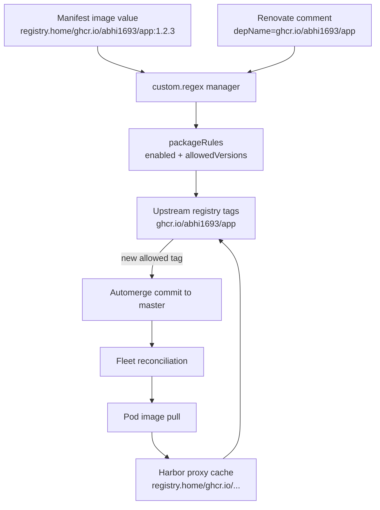

# Renovate

Zitadel Login source updates under `kubernetes/images/zitadel-login/` and its
image workflow require checks before branch automerge. Pull requests and
Renovate branches run the native ARM64 build, strict runtime scan, SBOM and smoke
without publishing; only `master` can promote immutable image tags. The normal
policy hook also checks the Login dependency-floor and workflow regressions.

This bundle runs the official Renovate image as an hourly single-run CronJob in
the `renovate` namespace. It scans explicitly selected GitOps, Coder, image
build, GitHub Actions, Python requirements, and Ansible collection files for
updates. Most enabled dependencies and lockfile maintenance use branch automerge
to update the default branch directly. Existing image version ranges and the
cluster-foundational exclusions still apply.

The shared policy sets `automerge: true`, `automergeType: "branch"`, and
`platformAutomerge: false`. `prCreation: "immediate"` allows branch automerge in
the same run that creates or rebases an update branch. Despite the option name,
successful branch automerge does not create a PR. Do not use `"approval"`,
`"not-pending"`, or `"status-success"`: Renovate can return newly written
branches as pending before attempting automerge with those settings.
Renovate may create a fallback PR if the branch merge itself fails; inspect the
job logs in that case. `recreateWhen: "always"` allows
updates to proceed after obsolete review PRs are closed, instead of interpreting
those closures as instructions to ignore a version.

When migrating from review PRs, close the existing Renovate PRs without merging
them after Fleet has applied this policy. An open PR blocks branch automerge.
Renovate will re-evaluate those updates on its next hourly run.

The CronJob retains at most one failed Job and expires terminal Jobs after two
hours. Persistent hourly failures continue to produce a current failed Job,
while a recovered run no longer leaves `KubeJobFailed` alert noise for a day.

Docker updates are disabled by default and re-enabled only for native
Dockerfile dependencies or image and OCI-chart names listed in `packageRules`.
Each existing automated image rule also defines the versioning scheme, allowed
version range, and branch automerge behavior for that image family.
Wardn AI image pins are the exception: they use the `git-refs` datasource with
`currentValue=master` so Renovate can update full commit-SHA image tags that
Docker tag versioning ignores.

Portfolio, the personal blog, the Wardn AI website, HA Sensors Gateway and Wardn
Hub Scoring track published GHCR images through the Docker datasource and
explicit enabled package rules. Their GitHub releases
start image builds, so release metadata alone cannot authorize an image update.
`scripts/check-renovate-policy.py` checks both their image comments and enabled
registry rules to keep the published-image workflow active.
The gateway stays within its `0.2.x` patch series and retains immutable digest
pins; a minor release requires a separate compatibility and capability review.

NUT (`docker.io/instantlinux/nut-upsd`) shares its OCI repository with Helm
charts. Its container rule accepts only `2.x.y-rN` tags and uses regex
versioning with a numeric build capture for `N`. This excludes bare chart
tags such as `2.8.5` and orders container revisions such as `r2` and `r10`
numerically. `scripts/check-renovate-policy.py` checks this tag boundary.

DevFeed tracks its twelve upstream GHCR images, including the MCP server and partner portal, through the `docker` datasource.
Only stable `X.Y.Z` tags are eligible; commit SHAs, moving tags, prereleases,
`v` prefixes, and build suffixes are excluded. Runtime, init-container, and
migration-hook updates share the `DevFeed images` group and retain digest pins.
GitHub release tracking cannot supply container digests: it resolves Git commit
hashes instead. Harbor remains the runtime pull-through cache.

For `image: repository:tag@sha256:digest`, the custom image matcher excludes `@`
from the repository portion so it captures the tag as `currentValue` and the
SHA-256 pin as `currentDigest`. This prevents release updates from replacing the
digest with a release tag. `python scripts/check-renovate-policy.py` checks these
captures and rejects malformed SHA-256 image pins in project manifests.



The comment controls where Renovate looks for tags. The manifest image controls
where Kubernetes pulls from. For proxy-cache pulls, keep the upstream registry
in `depName` and prefix the runtime image with `registry.home/`, for example:

```yaml
# renovate: datasource=docker depName=ghcr.io/abhi1693/shipyardhq
image: registry.home/ghcr.io/abhi1693/shipyardhq:1.5.13
```

## Terraform update validation

Coder Terraform provider, module, and lock file updates retain branch automerge
and require passing checks through a scoped `terraform` manager rule with
`ignoreTests: false` for `coder/templates/**`. The default test policy for other
dependencies is unchanged. The [Terraform validation workflow](../../../../../.github/workflows/terraform-validation.yml)
runs on pull requests and `master`/`renovate/**` pushes for template definitions,
lock files, and its validation and policy inputs. It executes formatting,
`init -backend=false -input=false`, and `validate` for all six templates without
applying resources. Initialization must precede validation so an old module
cache cannot hide removed inputs after a module upgrade.

## Secrets

`secrets.sops.yaml` creates:

- `renovate`: `RENOVATE_TOKEN`, `HARBOR_USERNAME`, and `HARBOR_PASSWORD`
- `harbor-registry`: image pull credentials for `registry.home`

`RENOVATE_TOKEN` is used for GitHub API access, Git writes, and authenticated
GHCR lookups. Harbor credentials allow Renovate to inspect private
`registry.home` repositories when a package rule intentionally points at the
local registry.

## Coverage and Safety Boundary

Renovate covers these non-foundational dependency types:

- explicitly annotated Kubernetes workload images and Fleet or HelmOp charts;
- Coder Dockerfiles, Terraform providers, modules, lock files, and published
  workspace image tags;
- GitHub Actions and release-pinned CI tools;
- Python CI requirements, NetBox image plugin requirements, and Ansible Galaxy
  collections; and
- Dockerfiles under `kubernetes/images/`.

Cluster-foundational dependencies are intentionally manual because their
upgrade requires coordinated bootstrap, compatibility, and recovery testing.
The exclusion includes K3s, kube-vip, Cilium and its CLI, CoreDNS, Metrics
Server, cert-manager, Rancher, Longhorn, MetalLB, CSI NFS, the embedded CNPG
operator chart, SOPS Secrets Operator, and Rancher system charts. Renovate must
not scan the Ansible `group_vars` that own the main platform pins.
The Fleet `system/apps/cilium` bundle is also excluded: moving Cilium's runtime
Helm ownership to Fleet does not change its manual upgrade policy.

`scripts/check-renovate-policy.py` enforces the ignored paths, rejects critical
package names and metadata, and requires literal non-critical GitOps images,
tags, and chart versions to carry Renovate metadata. Run it after changing
Renovate configuration or platform pins:

```sh
python scripts/check-renovate-policy.py
```

Some version sets remain manual even though they are not cluster-foundational.
The Valkey `helmop.yaml` chart pin requires a guarded `OnDelete` rollout, and
Rack Ops `secret-bootstrap.yaml` is a completed immutable Job whose name and
selector must advance together for a deliberate rerun. Both files are excluded
from scanning; their metadata still documents the upstream dependency.
The Jellyfin plugin bundle couples release URLs, checksums, ABI metadata, and
the generated metadata file. PyCharm and Portable Desktop pins likewise couple
versions, download URLs, and checksums. Native Renovate managers cannot safely
update those sets atomically, so they stay outside Renovate until a verified
generator is available.

## Adding Images

To add another automated image update:

1. Add a Renovate metadata comment next to the image, `imageName`, or `tag`
   value.
2. Use the upstream registry path in `depName` when the workload pulls through
   a Harbor proxy-cache path.
3. Add the image name to a matching `packageRules` entry.
4. Set an explicit `allowedVersions` range for the image.
5. Publish tags from the source repository in the version format selected by
   the package rule.

Do not add Renovate metadata to a critical path or dependency. If a dependency
needs multiple coupled file or checksum changes, add a deterministic generator
and validation before enrolling it.

For full commit-SHA image tags, use the `git-refs` form instead of the Docker
datasource:

```yaml
# renovate: datasource=git-refs depName=https://github.com/abhi1693/wardn-ai currentValue=master
image: registry.home/ghcr.io/abhi1693/wardn-ai-backend:<40-character-sha>
```

## Dashboard query validation

Job status, start/completion timestamps and CronJob ownership are deduplicated
by Kubernetes job identity before joins. This prevents historical kube-state-metrics
label changes or duplicate scrape series from causing many-to-many joins and
inflating retained-job counts. Latest completed duration selects the most recent
completion timestamp, not the longest retained run. Retention still limits which
jobs are visible; the dashboard is not a permanent execution history.

Run `python3 scripts/check-renovate-dashboard.py` for the duplicate-series and
latest-job regression checks, then query the live dashboard over the migration
window before accepting a change.

## Wardn Hub cohort updates

Hub backend, frontend and Codex app-server follow one grouped Docker package
rule with immutable digest pins and `automerge: false`. Source release events
start publication and are not an image-availability signal. Before merging the
grouped PR, verify successful native release scan/SBOM/smoke gates and signed
GitHub provenance for all three component images at the exact version/source.
The policy guard rejects mixed versions, missing digest pins, inconsistent
component digests and omitted init/hook images across all 14 references. A
grouped PR alone does not establish that its complete cohort was published.
Scoring tracks its private repository-owned runtime package independently.

## Wardn License Server cohort updates

License backend and frontend use the Docker datasource in one reviewed group
with digest pinning and `automerge: false`. Keep the API, console and direct-writer
migration hook together. Only stable `0.1.x` releases from `0.1.2` are eligible;
a minor-version change requires a compatibility review. This policy change
preserves the current image selections and does not roll the old images again.

A GitHub release starts the source repository's image workflow. Final component
tags appear only after native image checks, and publication across repositories
is not atomic. A grouped PR can therefore be incomplete while promotion is in
progress: verify both components, successful release scan/SBOM/smoke gates,
matching source/version, ARM64 manifests and Harbor digest equality before
merging. The source repository is private and explicitly disables unsupported
GitHub artifact attestations; do not claim signed provenance for this cohort.
The policy guard checks Docker metadata and limits review exceptions to the
Hub and License groups; other enabled dependencies retain branch automerge.
Once the verified release pins are applied, the strict License cohort guard
also rejects mixed versions, missing/invalid digest pins, mismatched backend
digests, swapped API/frontend containers and omitted/unreviewed references.
Run `python3 scripts/check-renovate-policy.py` and the app's
`tests/test_image_cohort.py` regressions before accepting an update.

## Restore-point writer branch checks

qBittorrent Smart Queues, Ryokan, K8s Recommendation Engine and Rack Ops keep
branch automerge enabled. A late exact-package Docker rule sets `ignoreTests:
false` for these four packages; the default `ignoreTests: true` for unrelated
dependencies and the final manual Chainguard helper rule are unchanged.
Infrastructure regressions runs on `renovate/**` branch pushes as well as master
and pull requests, so the writer update must pass checks before branch automerge.
Renovate waits for checks and may open a fallback PR for a failing branch; a test
failure must be repaired with coherent pins/cohorts before accepting that update.
See [Renovate automerge documentation](https://docs.renovatebot.com/key-concepts/automerge/).

The image regex manager updates image selections, not backup `--cohort` labels.
The dynamic `media-state-backups/tests/test_backup_cohort_policy.py` contract
requires identical full qBit controller/reconciler image references. Ryokan's
first backup label must be `qbit-<actual version>-ryokan-<actual version>` because
both images write its state. The qBit controller backs up only its own state:
its canonical label is `qbit-<actual version>`, with an optional historical
`-ryokan-X.Y.Z` suffix retained for existing labels. That context must be a strict
semantic version but need not match current Ryokan; a Ryokan-only upgrade leaves
the controller Pod spec and historical label unchanged. A stale own qBit version
or any other suffix fails the guard. No runtime label is rewritten by these tests.
It always requires Recommender clone/main image equality, and checks Recommender
and Rack cohort labels against their actual writer tags once each phased backup
init is installed. The per-app phase contracts require that init to remain first.
These tests derive release versions from manifests; no release number is frozen
in the assertion. Update affected pins and labels together in the same Git change.
This gate does not add a restart, disable automerge, or verify image provenance.

## Pre-start backup helper pin

The public `cgr.dev/chainguard/python` helper has Docker metadata but automatic
updates stay disabled in the final package rule. Its free rolling channel can
change Python or SQLite major versions. Review an immutable index across every
helper consumer, verify the exact upstream signature/identity, scan and inventory
both architectures, and execute the real helper profiles before changing it.
Normal Fleet storage acceptance runs on ARM64 before an application stops.
This boundary does not change automerge for other enabled dependencies.

The personal blog keeps its existing single-image Docker branch-update policy.
Its source release starts the real CMS image build; only final registry tags
published after native scan/SBOM/runtime gates are eligible. The policy guard
rejects a return to source-release tracking or removal of its enabled registry
rule. Verify the release commit, ARM64 index/config and signed GitHub attestation
before accepting the Fleet rollout. No review exception or image selection is
introduced by the tracking change.
